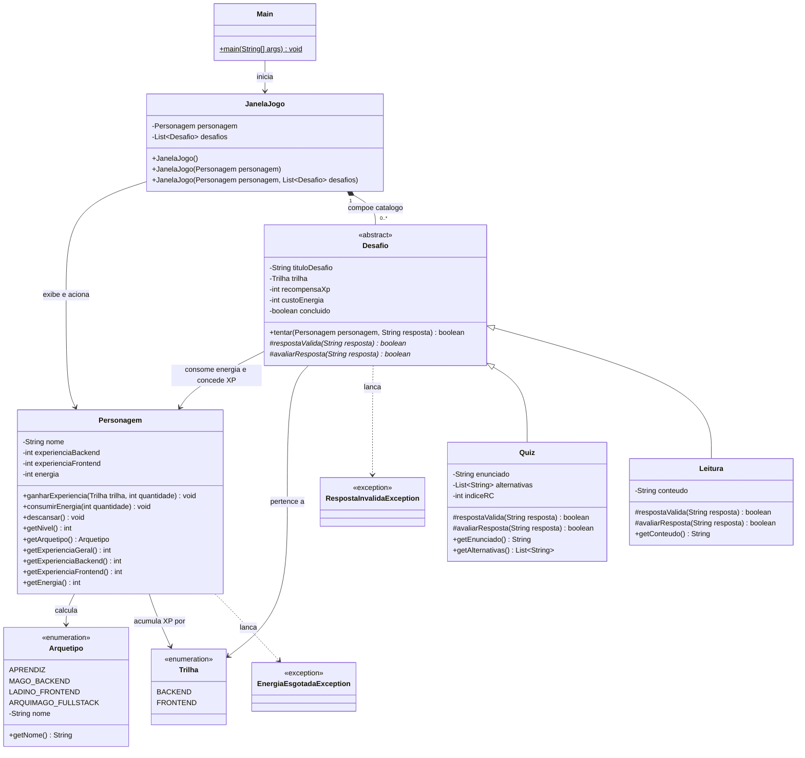

# Modelo de dominio

Modelo orientado a objetos para aplicacao desktop local em Java 21 + Swing, mantendo o estado da sessao em memoria.

## Classes e tipos implementados

- **Personagem:** encapsula `nome`, `energia`, `experienciaBackend` e `experienciaFrontend`; calcula dinamicamente `getExperienciaGeral()`, `getNivel()` e `getArquetipo()`. Controla ganho de XP (`ganharExperiencia`), gasto de energia (`consumirEnergia`) e recuperacao (`descansar`).
- **Trilha (`enum`):** representa os eixos de estudo (`BACKEND` e `FRONTEND`).
- **Arquetipo (`enum`):** representa a especializacao calculada pelo perfil de estudos (`APRENDIZ`, `MAGO_BACKEND`, `LADINO_FRONTEND` e `ARQUIMAGO_FULLSTACK`), com nome formatado para exibicao.
- **Desafio (`abstract class`):** define os atributos imutaveis `tituloDesafio`, `trilha`, `recompensaXp`, `custoEnergia` e o controle de recompensa unica `concluido`. Centraliza o fluxo de execucao no Template Method `public final boolean tentar(Personagem, String)` e delega `respostaValida` e `avaliarResposta` para as subclasses.
- **Quiz (`extends Desafio`):** especializa `Desafio` com `enunciado`, lista imutavel `alternativas` (`List.copyOf`) e indice da alternativa correta (`indiceRC`).
- **Leitura (`extends Desafio`):** especializa `Desafio` com `conteudo` textual, concluido mediante confirmacao explicita (`"CONFIRMAR"`).
- **Excecoes de dominio:**
  - `EnergiaEsgotadaException`: lancada quando o custo da tentativa excede a energia atual do personagem, preservando o saldo anterior.
  - `RespostaInvalidaException`: lancada antes do consumo de energia quando a entrada informada viola o formato esperado pelo desafio.
- **JanelaJogo (`extends JFrame`):** interface grafica Swing que compoe `Personagem` e `List<Desafio>`, exibindo perfil, avatares evolutivos em tres estagios com narrativa personalizada e painel polimorfico de atividades (`Quiz` e `Leitura`), delegando toda regra de negocio aos objetos de dominio.
- **Main:** ponto de entrada da aplicacao desktop na thread de eventos do Swing (`SwingUtilities.invokeLater`).

## Diagrama de classes UML

## Separacao de responsabilidades e pilares de POO

1. **Encapsulamento:** `Personagem` e `Desafio` nao expoem setters para atributos sensiveis (`energia`, `experienciaBackend`, `experienciaFrontend`, `concluido`). Nivel e arquetipo sao derivados do XP acumulado, impedindo estados inconsistentes.
2. **Abstracao, Heranca e Polimorfismo:** `Desafio` estabelece um contrato unico (`tentar`) consumido pela `JanelaJogo`, enquanto `Quiz` e `Leitura` sobrescrevem a validacao e correcao da resposta sem duplicar regras de energia ou recompensa unica.
3. **Composicao e Colecoes Imutaveis:** `Quiz` protege suas alternativas com `List.copyOf(...)` e `JanelaJogo` mantem copia imutavel de `List<Desafio>`.
4. **Tratamento de Excecoes:** falhas de regra de negocio (`EnergiaEsgotadaException` e `RespostaInvalidaException`) interrompem a operacao preservando o estado anterior do objeto e sao traduzidas em feedback visual na camada Swing.
